# 02 · Pantallas, una por una

Cada bloque dice: qué archivo de la app corresponde, qué reglas de datos aplican y los **textos literales** de cada estado. Las capturas están en `capturas/pantallas/`.

**Regla de oro (del propio proyecto):** nada de datos inventados. Los nombres, horas y números de las capturas son ejemplos. Todo lo marcado *por validar* debe comprobarse en el código o con el equipo antes de mostrarse como verdad.

---

## 01 · Cargando e inicio de sesión

**Archivo(s) en la app:** `Pantalla compartida de carga/login (S43, `feature/home` y `ui/navigation`) en su variante supervisada. Verificar el archivo real antes de tocar.`

El inicio de sesión es solo con Google. Cuatro mensajes de error distintos (servicio no disponible, sin Internet, sesión caducada, desconocido) en lugar de uno genérico. "Restaurando tu sesión…" breve al arrancar; si falla cae al login (pregunta técnica 2). Los mensajes dependen de poder distinguir los errores de la API (pregunta 1).

Lámina completa: `capturas/laminas/01-Acceso.png`

### 1 · CARGANDO

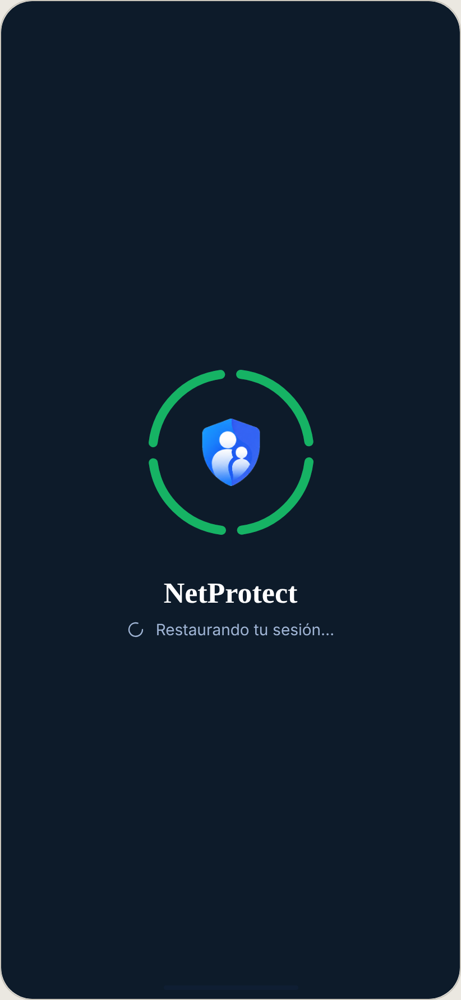

Textos (en orden de lectura):

- NetProtect

### 2 · INICIO DE SESIÓN · SERVICIO LISTO

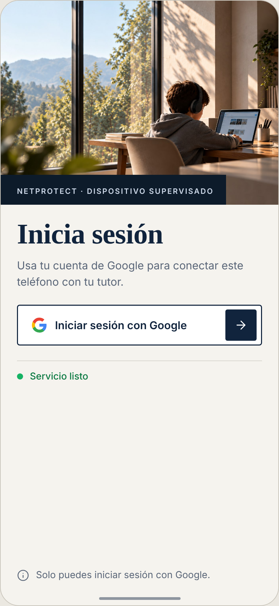

Textos (en orden de lectura):

- NETPROTECT · DISPOSITIVO SUPERVISADO
- Inicia sesión
- Usa tu cuenta de Google para conectar este teléfono con tu tutor.
- Servicio listo

### 3 · SERVICIO NO DISPONIBLE

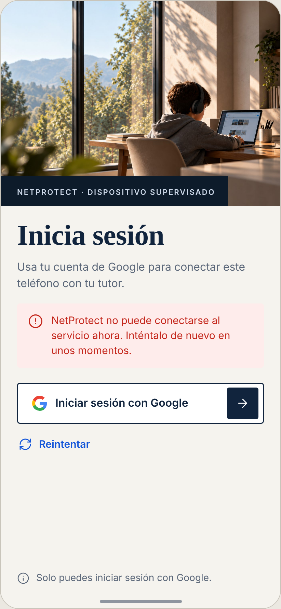

Textos (en orden de lectura):

- NETPROTECT · DISPOSITIVO SUPERVISADO
- Inicia sesión
- Usa tu cuenta de Google para conectar este teléfono con tu tutor.
- NetProtect no puede conectarse al servicio ahora. Inténtalo de nuevo en unos momentos.

### 4 · SIN INTERNET

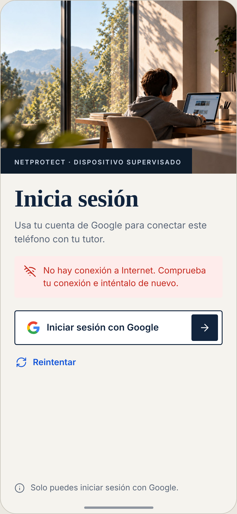

Textos (en orden de lectura):

- NETPROTECT · DISPOSITIVO SUPERVISADO
- Inicia sesión
- Usa tu cuenta de Google para conectar este teléfono con tu tutor.
- No hay conexión a Internet. Comprueba tu conexión e inténtalo de nuevo.

### 5 · TU SESIÓN CADUCÓ

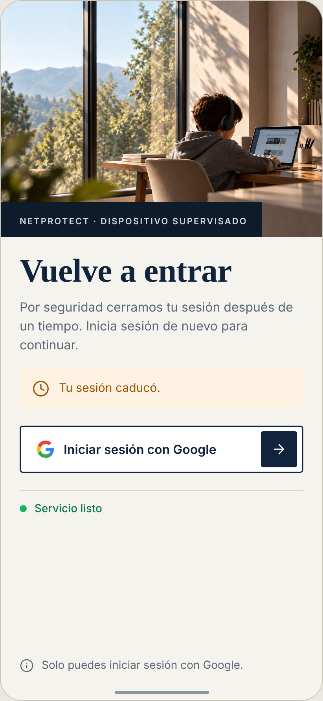

Textos (en orden de lectura):

- NETPROTECT · DISPOSITIVO SUPERVISADO
- Vuelve a entrar
- Por seguridad cerramos tu sesión después de un tiempo. Inicia sesión de nuevo para continuar.
- Tu sesión caducó.
- Servicio listo

---

## 02 · Vincular este dispositivo

**Archivo(s) en la app:** `mobile/app/src/main/java/com/netprotect/app/feature/supervised/link/LinkDeviceScreen.kt`

Campo de 6 casillas (solo dígitos, pegar los 6 de una vez). El botón se activa con los 6 dígitos. NO hay cuenta regresiva del código porque no se sabe si el backend devuelve la expiración (pregunta 3). Errores mapeados con `pairing.py` (código inválido/vencido, demasiados intentos, sin conexión).

Lámina completa: `capturas/laminas/02-Vincular.png`

### 1 · ESPERANDO EL CÓDIGO

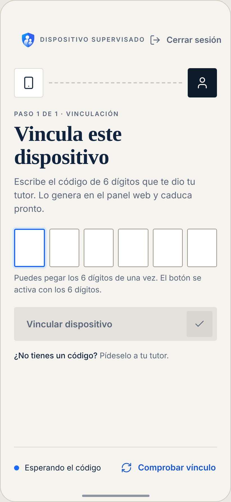

Textos (en orden de lectura):

- DISPOSITIVO SUPERVISADO
- PASO 1 DE 1 · VINCULACIÓN
- Vincula este dispositivo
- Escribe el código de 6 dígitos que te dio tu tutor. Lo genera en el panel web y caduca pronto.
- Puedes pegar los 6 dígitos de una vez. El botón se activa con los 6 dígitos.
- Vincular dispositivo
- ¿No tienes un código?

### 2 · VINCULANDO

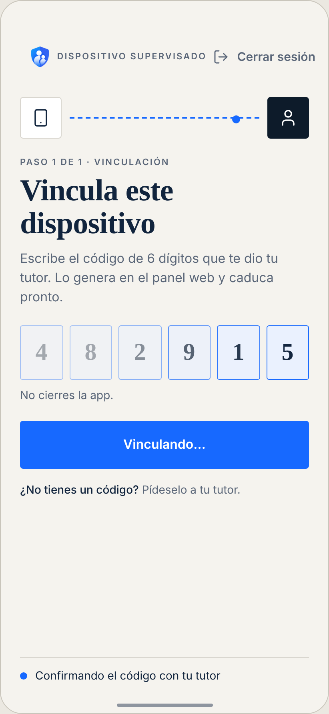

Textos (en orden de lectura):

- DISPOSITIVO SUPERVISADO
- PASO 1 DE 1 · VINCULACIÓN
- Vincula este dispositivo
- Escribe el código de 6 dígitos que te dio tu tutor. Lo genera en el panel web y caduca pronto.
- No cierres la app.
- Vinculando…
- ¿No tienes un código?

### 3 · CÓDIGO INVÁLIDO O VENCIDO

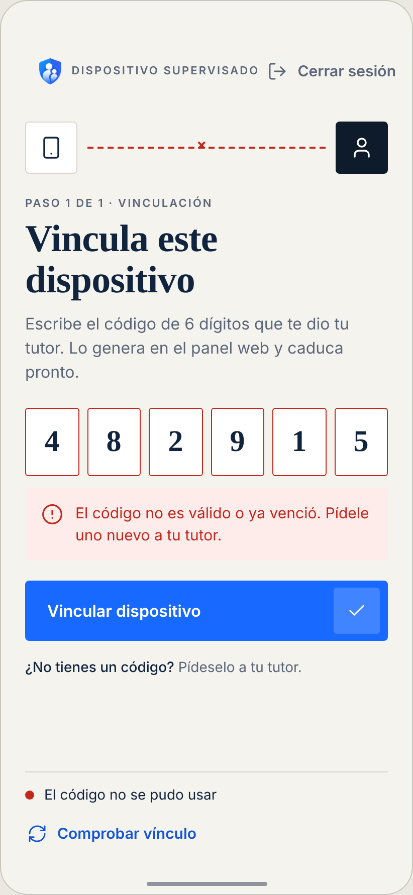

Textos (en orden de lectura):

- DISPOSITIVO SUPERVISADO
- ×
- PASO 1 DE 1 · VINCULACIÓN
- Vincula este dispositivo
- Escribe el código de 6 dígitos que te dio tu tutor. Lo genera en el panel web y caduca pronto.
- El código no es válido o ya venció. Pídele uno nuevo a tu tutor.
- Vincular dispositivo
- ¿No tienes un código?

---

## 03 · Inicio (dispositivo vinculado)

**Archivo(s) en la app:** `mobile/app/src/main/java/com/netprotect/app/feature/supervised/linked/LinkedDeviceScreen.kt`

Panel navy con el Sello (4 arcos) y titular de estado: "Todo funciona" = 4 permisos + comunicación reciente; "Falta un paso" = algún permiso pendiente (botón "Revisar permisos"); "Sin reporte reciente" = permisos completos pero sin latido (umbral por definir, pregunta 16; propuesta: 5 min = 5 latidos perdidos). Con vista remota en curso aparece el banner azul "Tu tutor está viendo tu pantalla" + "Detener" sobre TODA pantalla. Datos reales disponibles tras S48: `device_name`, `Build.VERSION.RELEASE` (local), lista de tutores, `status.last_seen_at`. El nombre "Andres Mosquera" de las capturas es ejemplo.

Lámina completa: `capturas/laminas/03-Vinculado.png`

### 1 · TODO FUNCIONA

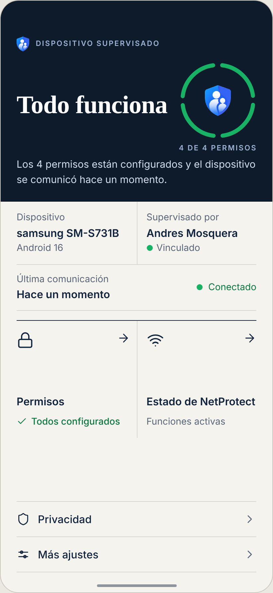

Textos (en orden de lectura):

- DISPOSITIVO SUPERVISADO
- Todo funciona
- 4 DE 4 PERMISOS
- Los 4 permisos están configurados y el dispositivo se comunicó hace un momento.
- Dispositivo
- samsung SM-S731B
- Android 16
- Supervisado por
- Andres Mosquera
- Última comunicación
- Hace un momento
- Permisos
- Estado de NetProtect
- Funciones activas

### 2 · FALTA UN PASO

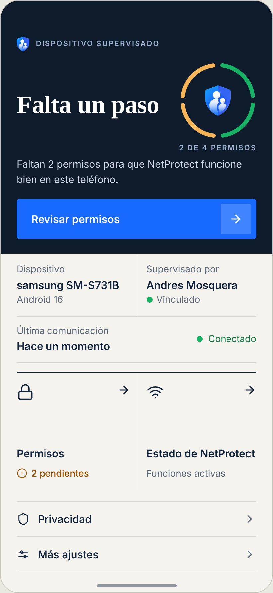

Textos (en orden de lectura):

- DISPOSITIVO SUPERVISADO
- Falta un paso
- 2 DE 4 PERMISOS
- Faltan 2 permisos para que NetProtect funcione bien en este teléfono.
- Revisar permisos
- Dispositivo
- samsung SM-S731B
- Android 16
- Supervisado por
- Andres Mosquera
- Última comunicación
- Hace un momento
- Permisos
- Estado de NetProtect
- Funciones activas

### 3 · SIN REPORTE RECIENTE

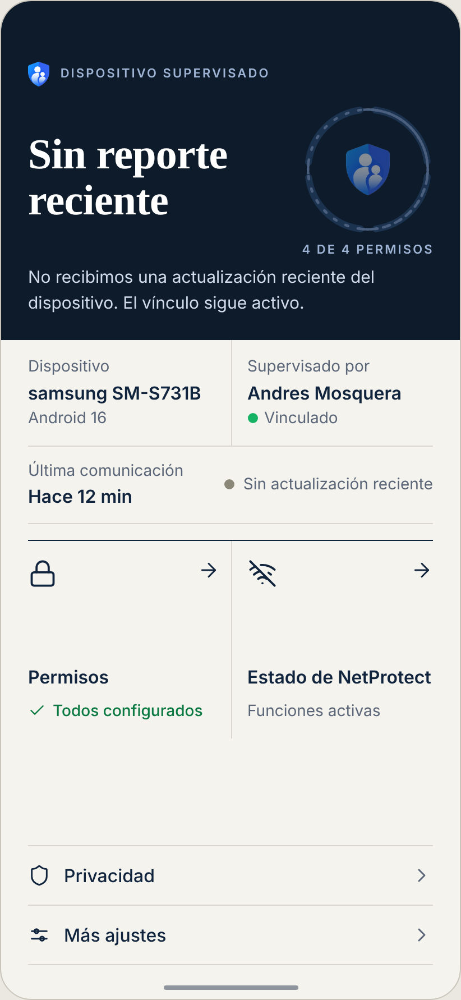

Textos (en orden de lectura):

- DISPOSITIVO SUPERVISADO
- Sin reporte reciente
- 4 DE 4 PERMISOS
- No recibimos una actualización reciente del dispositivo. El vínculo sigue activo.
- Dispositivo
- samsung SM-S731B
- Android 16
- Supervisado por
- Andres Mosquera
- Última comunicación
- Hace 12 min
- Permisos
- Estado de NetProtect
- Funciones activas

### 4 · VISTA REMOTA EN CURSO

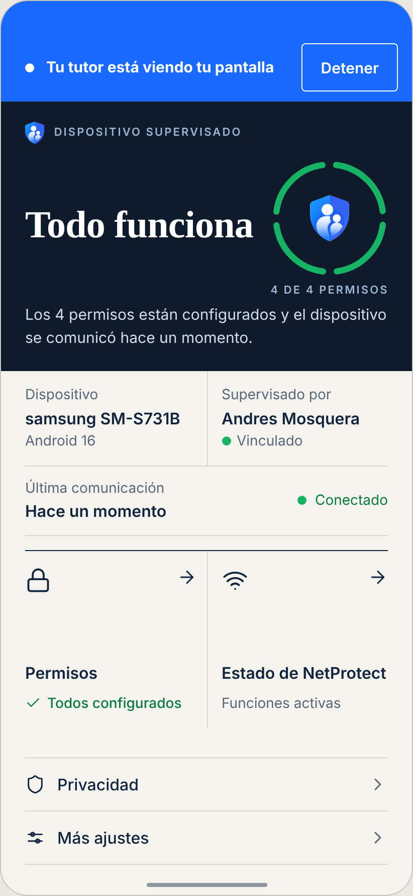

Textos (en orden de lectura):

- Tu tutor está viendo tu pantalla
- Detener
- DISPOSITIVO SUPERVISADO
- Todo funciona
- 4 DE 4 PERMISOS
- Los 4 permisos están configurados y el dispositivo se comunicó hace un momento.
- Dispositivo
- samsung SM-S731B
- Android 16
- Supervisado por
- Andres Mosquera
- Última comunicación
- Hace un momento
- Permisos
- Estado de NetProtect
- Funciones activas

---

## 04 · Permisos

**Archivo(s) en la app:** `mobile/app/src/main/java/com/netprotect/app/feature/supervised/permissions/PermissionsScreen.kt`

Recorrido vertical ("rail") con el siguiente paso resaltado y los otros cuatro estados. Los textos de cada permiso salen de la app actual (inventario S40). Re-comprobar al volver de Ajustes (pregunta 6: cómo se comprueba cada permiso).

Lámina completa: `capturas/laminas/04-Permisos.png`

### 1 · DOS PERMISOS PENDIENTES

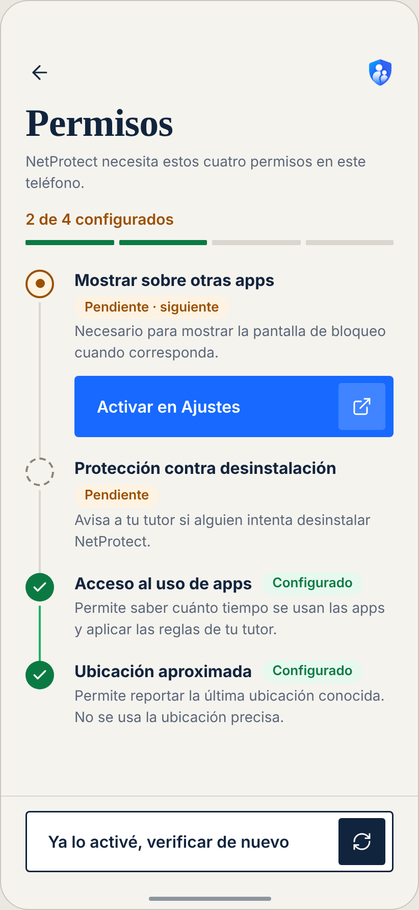

Textos (en orden de lectura):

- Permisos
- NetProtect necesita estos cuatro permisos en este teléfono.
- 2 de 4 configurados
- Mostrar sobre otras apps
- Pendiente · siguiente
- Necesario para mostrar la pantalla de bloqueo cuando corresponda.
- Activar en Ajustes
- Protección contra desinstalación
- Pendiente
- Avisa a tu tutor si alguien intenta desinstalar NetProtect.
- Acceso al uso de apps
- Configurado
- Permite saber cuánto tiempo se usan las apps y aplicar las reglas de tu tutor.
- Ubicación aproximada
- Permite reportar la última ubicación conocida. No se usa la ubicación precisa.
- Ya lo activé, verificar de nuevo

### 2 · TODOS CONFIGURADOS

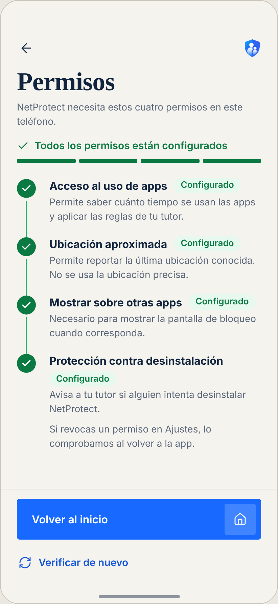

Textos (en orden de lectura):

- Permisos
- NetProtect necesita estos cuatro permisos en este teléfono.
- Acceso al uso de apps
- Configurado
- Permite saber cuánto tiempo se usan las apps y aplicar las reglas de tu tutor.
- Ubicación aproximada
- Permite reportar la última ubicación conocida. No se usa la ubicación precisa.
- Mostrar sobre otras apps
- Necesario para mostrar la pantalla de bloqueo cuando corresponda.
- Protección contra desinstalación
- Avisa a tu tutor si alguien intenta desinstalar NetProtect.
- Si revocas un permiso en Ajustes, lo comprobamos al volver a la app.
- Volver al inicio

---

## 05 · Estado de NetProtect

**Archivo(s) en la app:** `mobile/app/src/main/java/com/netprotect/app/feature/supervised/SupervisedViews.kt / `SupervisedShell.kt` (hoy Servicios es el hueco de S50)`

Qué funciones están activas: Reporte del dispositivo (cada minuto con la app abierta, tomado de `HEARTBEAT_INTERVAL_MS = 60_000L`), Control de apps, Ubicación aproximada (cada ~15 min, NUNCA "en tiempo real"; "Sin confirmar" si aún no hay dato), Notificaciones permanentes. La frase "NetProtect no graba la pantalla ni controla el dispositivo" está POR VALIDAR (pregunta 12): no la publiques hasta confirmarla con el código.

Lámina completa: `capturas/laminas/05-Estado.png`

### 1 · TODO ACTIVO

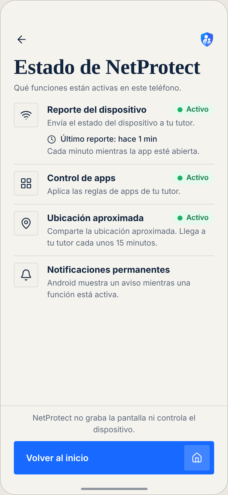

Textos (en orden de lectura):

- Estado de NetProtect
- Qué funciones están activas en este teléfono.
- Reporte del dispositivo
- Envía el estado del dispositivo a tu tutor.
- Cada minuto mientras la app esté abierta.
- Control de apps
- Aplica las reglas de apps de tu tutor.
- Ubicación aproximada
- Comparte la ubicación aproximada. Llega a tu tutor cada unos 15 minutos.
- Notificaciones permanentes
- Android muestra un aviso mientras una función está activa.
- NetProtect no graba la pantalla ni controla el dispositivo.
- Volver al inicio

### 2 · VISTA REMOTA EN CURSO

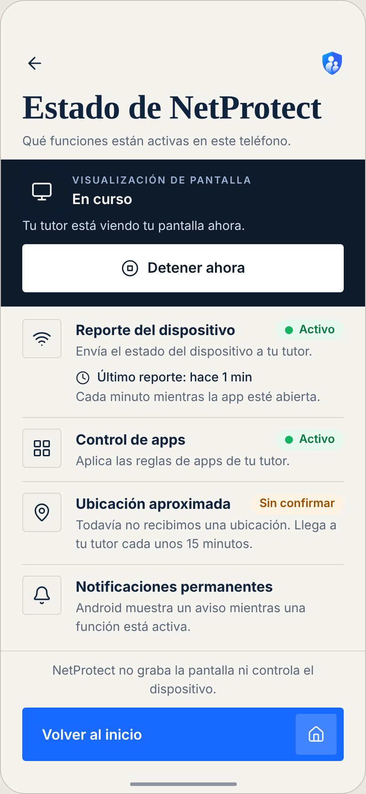

Textos (en orden de lectura):

- Estado de NetProtect
- Qué funciones están activas en este teléfono.
- VISUALIZACIÓN DE PANTALLA
- En curso
- Tu tutor está viendo tu pantalla ahora.
- Reporte del dispositivo
- Envía el estado del dispositivo a tu tutor.
- Cada minuto mientras la app esté abierta.
- Control de apps
- Aplica las reglas de apps de tu tutor.
- Ubicación aproximada
- Sin confirmar
- Todavía no recibimos una ubicación. Llega a tu tutor cada unos 15 minutos.
- Notificaciones permanentes
- Android muestra un aviso mientras una función está activa.
- NetProtect no graba la pantalla ni controla el dispositivo.
- Volver al inicio

---

## 06 · Consentimiento y notificaciones permanentes

**Archivo(s) en la app:** `mobile/app/src/main/java/com/netprotect/app/feature/supervised/SupervisedShell.kt (tarjeta de consentimiento actual) + core/screenshare/ (S50)`

Tres pasos: 1 Leer, 2 Autorizar (casilla obligatoria, caduca en 2 min según el documento fuente; el contador de la captura es de ejemplo), 3 Android (el diálogo del sistema se muestra aparte, sin imitarlo; "Atrás" no cuenta como aceptar). "Ahora no" siempre disponible. La lámina muestra además las tres notificaciones permanentes de Android. Riesgo técnico alto (realtime, B-02).

Lámina completa: `capturas/laminas/06-Consentimiento.png`

### 1 · SIN AUTORIZAR

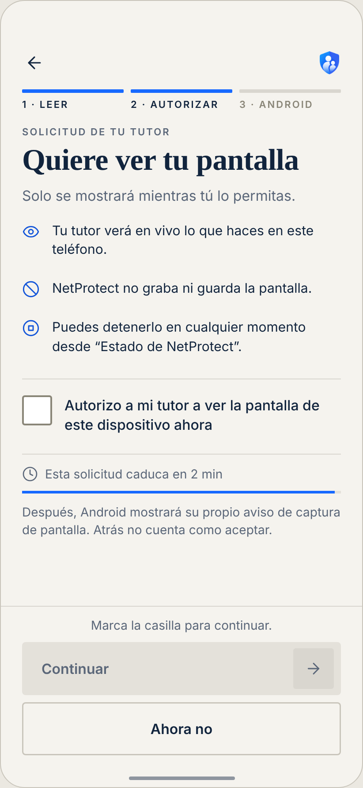

Textos (en orden de lectura):

- SOLICITUD DE TU TUTOR
- Quiere ver tu pantalla
- Solo se mostrará mientras tú lo permitas.
- Tu tutor verá en vivo lo que haces en este teléfono.
- NetProtect no graba ni guarda la pantalla. (POR VALIDAR)
- Puedes detenerlo en cualquier momento desde “Estado de NetProtect”.
- [casilla] Autorizo a mi tutor a ver la pantalla de este dispositivo ahora
- Esta solicitud caduca en 2 min
- Después, Android mostrará su propio aviso de captura de pantalla. Atrás no cuenta como aceptar.
- Marca la casilla para continuar.
- Continuar (deshabilitado hasta marcar)
- Ahora no

### 2 · AUTORIZADO

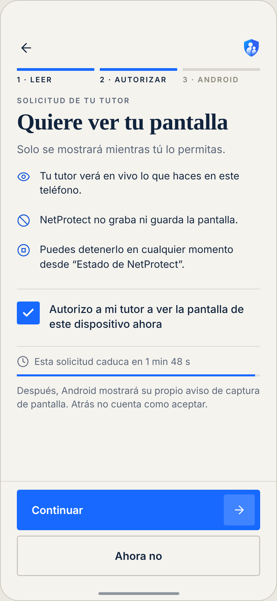

Textos (en orden de lectura):

- SOLICITUD DE TU TUTOR
- Quiere ver tu pantalla
- Solo se mostrará mientras tú lo permitas.
- Tu tutor verá en vivo lo que haces en este teléfono.
- NetProtect no graba ni guarda la pantalla. (POR VALIDAR)
- Puedes detenerlo en cualquier momento desde “Estado de NetProtect”.
- [casilla] Autorizo a mi tutor a ver la pantalla de este dispositivo ahora
- Esta solicitud caduca en 1 min 48 s (contador)
- Después, Android mostrará su propio aviso de captura de pantalla. Atrás no cuenta como aceptar.
- Continuar
- Ahora no

### 3 · NOTIFICACIONES PERMANENTES DE ANDROID

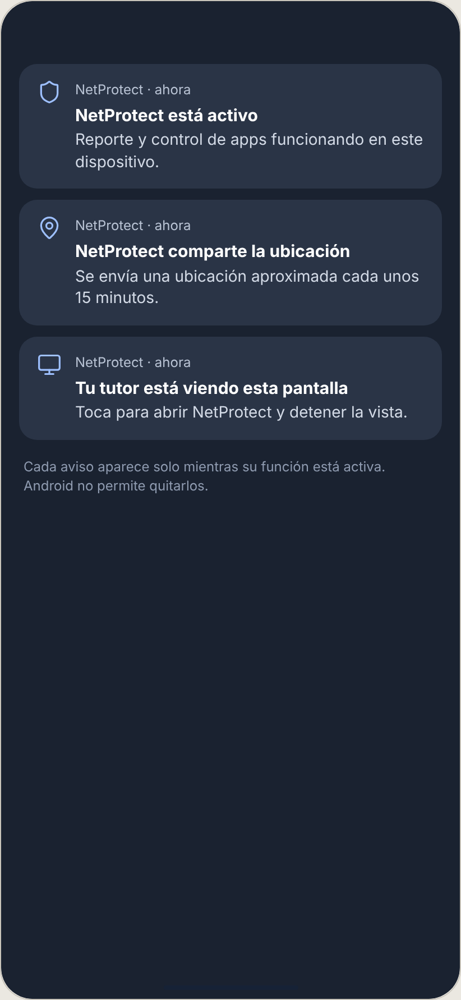

Textos (en orden de lectura):

- NetProtect · ahora
- NetProtect está activo
- Reporte y control de apps funcionando en este dispositivo.
- NetProtect comparte la ubicación
- Se envía una ubicación aproximada cada unos 15 minutos.
- Tu tutor está viendo esta pantalla
- Toca para abrir NetProtect y detener la vista.
- Cada aviso aparece solo mientras su función está activa. Android no permite quitarlos.

---

## 07 · App bloqueada (7 variantes)

**Archivo(s) en la app:** `mobile/app/src/main/java/com/netprotect/app/feature/supervised/block/BlockScreenContent.kt y BlockPresentation.kt`

Mismos 7 motivos que ya implementa S49 (directo, límite diario, límite semanal, fuera de horario, categoría, horario escolar, solo apps aprobadas); el trabajo v2 es de estilo (panel navy, candado con animación de una sola vez), no de lógica. Nota de pie "El bloqueo cubre la pantalla de la app, pero no la cierra" por validar (pregunta 8).

Lámina completa: `capturas/laminas/07-Bloqueo.png`

### 1 · BLOQUEO DIRECTO

Textos (en orden de lectura):

- Nombre de la app
- Ejemplo de app bloqueada
- Tu tutor bloqueó esta app.
- No puedes usarla por ahora. Si crees que es un error, habla con tu tutor.
- El bloqueo cubre la pantalla de la app, pero no la cierra.
- Ir al inicio

### 2 · LÍMITE DIARIO

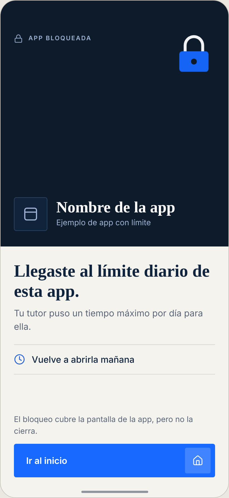

Textos (en orden de lectura):

- Nombre de la app
- Ejemplo de app con límite
- Llegaste al límite diario de esta app.
- Tu tutor puso un tiempo máximo por día para ella.
- El bloqueo cubre la pantalla de la app, pero no la cierra.
- Ir al inicio

### 3 · LÍMITE SEMANAL

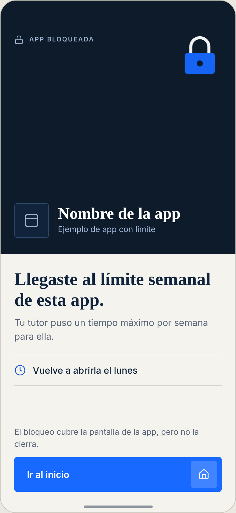

Textos (en orden de lectura):

- Nombre de la app
- Ejemplo de app con límite
- Llegaste al límite semanal de esta app.
- Tu tutor puso un tiempo máximo por semana para ella.
- El bloqueo cubre la pantalla de la app, pero no la cierra.
- Ir al inicio

### 4 · FUERA DE HORARIO

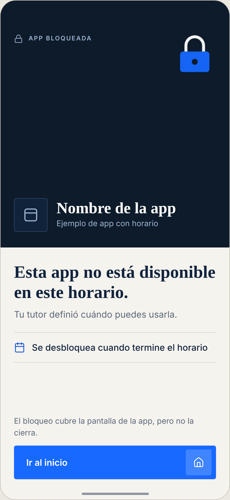

Textos (en orden de lectura):

- Nombre de la app
- Ejemplo de app con horario
- Esta app no está disponible en este horario.
- Tu tutor definió cuándo puedes usarla.
- El bloqueo cubre la pantalla de la app, pero no la cierra.
- Ir al inicio

### 5 · CATEGORÍA BLOQUEADA

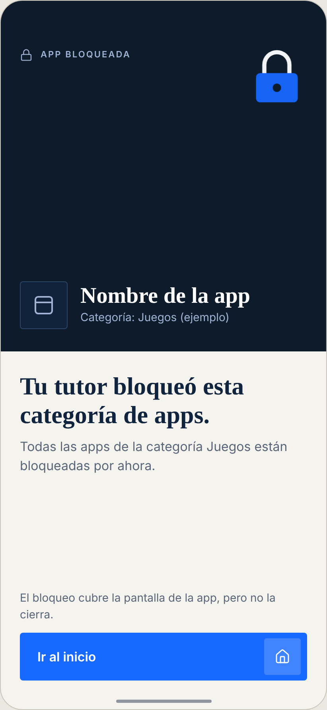

Textos (en orden de lectura):

- Nombre de la app
- Categoría: Juegos (ejemplo)
- Tu tutor bloqueó esta categoría de apps.
- Todas las apps de la categoría Juegos están bloqueadas por ahora.
- El bloqueo cubre la pantalla de la app, pero no la cierra.
- Ir al inicio

### 6 · HORARIO ESCOLAR

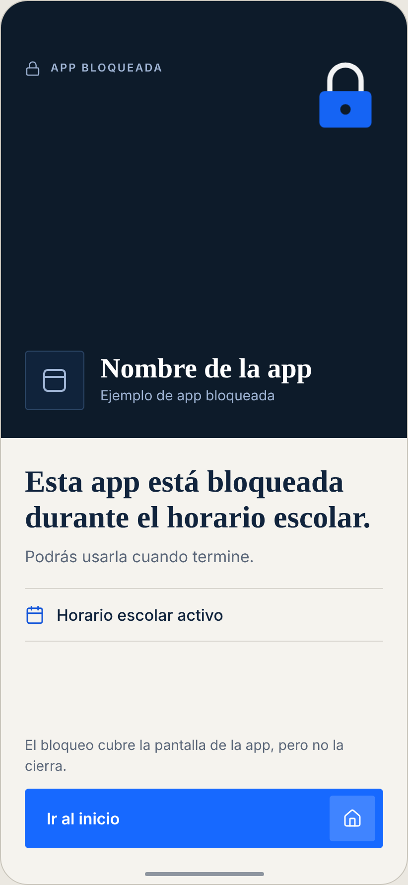

Textos (en orden de lectura):

- Nombre de la app
- Ejemplo de app bloqueada
- Esta app está bloqueada durante el horario escolar.
- Podrás usarla cuando termine.
- El bloqueo cubre la pantalla de la app, pero no la cierra.
- Ir al inicio

### 7 · SOLO APPS APROBADAS

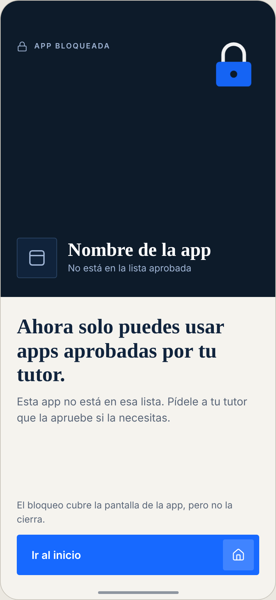

Textos (en orden de lectura):

- Nombre de la app
- No está en la lista aprobada
- Ahora solo puedes usar apps aprobadas por tu tutor.
- Esta app no está en esa lista. Pídele a tu tutor que la apruebe si la necesitas.
- El bloqueo cubre la pantalla de la app, pero no la cierra.
- Ir al inicio

---

## 08 · Letra al 200 %

**Archivo(s) en la app:** `Todas las pantallas`

Comprobación de que Inicio, Permisos y Estado resisten escala de fuente 200 %: nada de alturas fijas en texto, los botones crecen (`heightIn(min = 60.dp)`), nada se corta. Cubre B-06 (botones aplastados con letra grande).

Lámina completa: `capturas/laminas/08-Letra200.png`

### DISPOSITIVO VINCULADO · 200 %

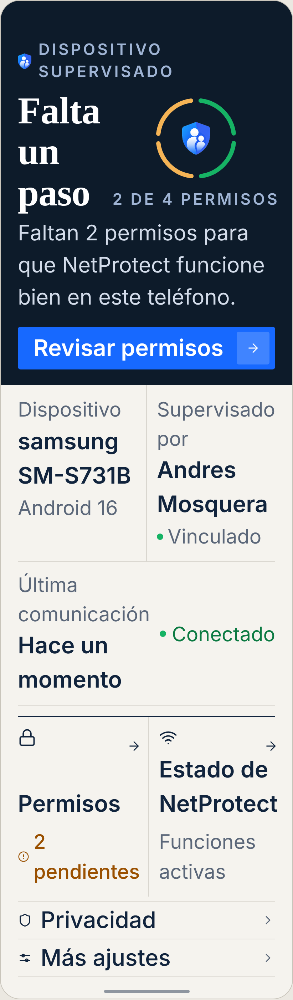

Textos (en orden de lectura):

- DISPOSITIVO SUPERVISADO
- Falta un paso
- 2 DE 4 PERMISOS
- Faltan 2 permisos para que NetProtect funcione bien en este teléfono.
- Revisar permisos
- Dispositivo
- samsung SM-S731B
- Android 16
- Supervisado por
- Andres Mosquera
- Última comunicación
- Hace un momento
- Permisos
- Estado de NetProtect
- Funciones activas

### PERMISOS · 200 %

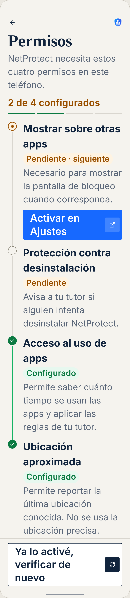

Textos (en orden de lectura):

- Permisos
- NetProtect necesita estos cuatro permisos en este teléfono.
- 2 de 4 configurados
- Mostrar sobre otras apps
- Pendiente · siguiente
- Necesario para mostrar la pantalla de bloqueo cuando corresponda.
- Activar en Ajustes
- Protección contra desinstalación
- Pendiente
- Avisa a tu tutor si alguien intenta desinstalar NetProtect.
- Acceso al uso de apps
- Configurado
- Permite saber cuánto tiempo se usan las apps y aplicar las reglas de tu tutor.
- Ubicación aproximada
- Permite reportar la última ubicación conocida. No se usa la ubicación precisa.
- Ya lo activé, verificar de nuevo

### ESTADO DE NETPROTECT · 200 %

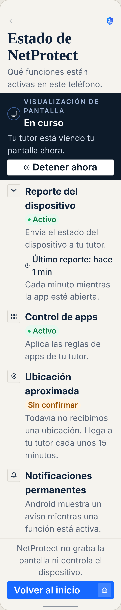

Textos (en orden de lectura):

- Estado de NetProtect
- Qué funciones están activas en este teléfono.
- VISUALIZACIÓN DE PANTALLA
- En curso
- Tu tutor está viendo tu pantalla ahora.
- Reporte del dispositivo
- Envía el estado del dispositivo a tu tutor.
- Cada minuto mientras la app esté abierta.
- Control de apps
- Aplica las reglas de apps de tu tutor.
- Ubicación aproximada
- Sin confirmar
- Todavía no recibimos una ubicación. Llega a tu tutor cada unos 15 minutos.
- Notificaciones permanentes
- Android muestra un aviso mientras una función está activa.
- NetProtect no graba la pantalla ni controla el dispositivo.
- Volver al inicio

---

## 10 · Sesión, vínculo, modo y privacidad

**Archivo(s) en la app:** `mobile/app/src/main/java/com/netprotect/app/feature/supervised/ (nuevas pantallas)`

Más ajustes; confirmación de cerrar sesión; Cambiar de modo (POR VALIDAR: puede no existir); "Este dispositivo ya no está vinculado" cuando el tutor desvincula (solo el tutor puede desvincular; el menor ve "Vincular de nuevo"; necesita que la app detecte el desvinculado, pregunta 14); Privacidad (la frase sobre grabación está pendiente, pregunta 12).

Lámina completa: `capturas/laminas/10-Decisiones.png`

### 1 · MÁS AJUSTES

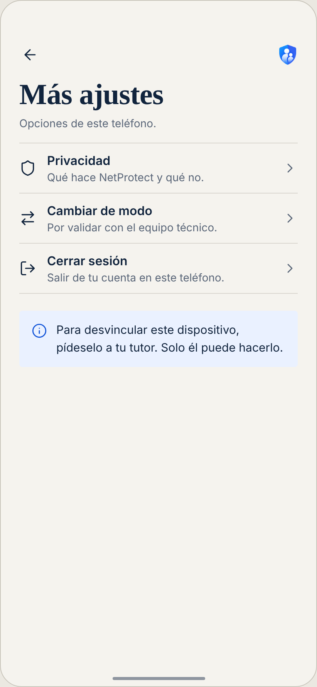

Textos (en orden de lectura):

- Más ajustes
- Opciones de este teléfono.
- Privacidad
- Qué hace NetProtect y qué no.
- Cambiar de modo
- Por validar con el equipo técnico.
- Cerrar sesión
- Salir de tu cuenta en este teléfono.
- Para desvincular este dispositivo, pídeselo a tu tutor. Solo él puede hacerlo.

### 2 · CONFIRMAR CIERRE DE SESIÓN

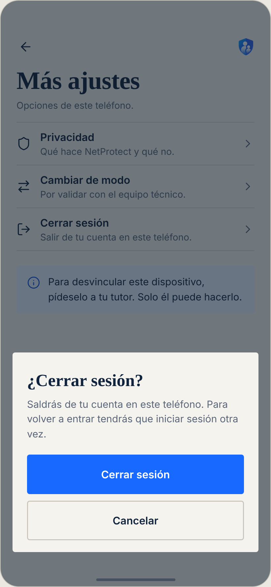

Textos (en orden de lectura):

- Más ajustes
- Opciones de este teléfono.
- Privacidad
- Qué hace NetProtect y qué no.
- Cambiar de modo
- Por validar con el equipo técnico.
- Cerrar sesión
- Salir de tu cuenta en este teléfono.
- Para desvincular este dispositivo, pídeselo a tu tutor. Solo él puede hacerlo.
- ¿Cerrar sesión?
- Saldrás de tu cuenta en este teléfono. Para volver a entrar tendrás que iniciar sesión otra vez.
- Cancelar

### 3 · CAMBIAR DE MODO

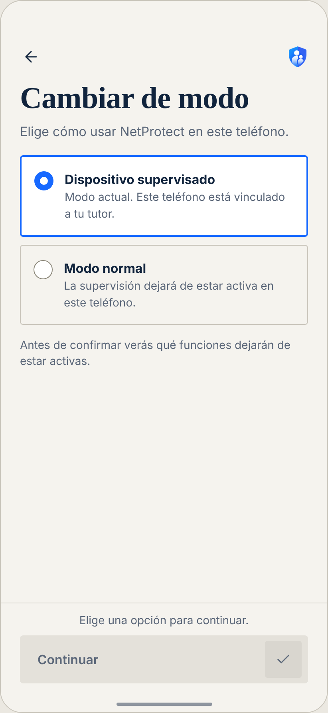

Textos (en orden de lectura):

- Cambiar de modo
- Elige cómo usar NetProtect en este teléfono.
- Dispositivo supervisado
- Modo actual. Este teléfono está vinculado a tu tutor.
- Modo normal
- La supervisión dejará de estar activa en este teléfono.
- Antes de confirmar verás qué funciones dejarán de estar activas.
- Elige una opción para continuar.
- Continuar

### 4 · DISPOSITIVO DESVINCULADO POR EL TUTOR

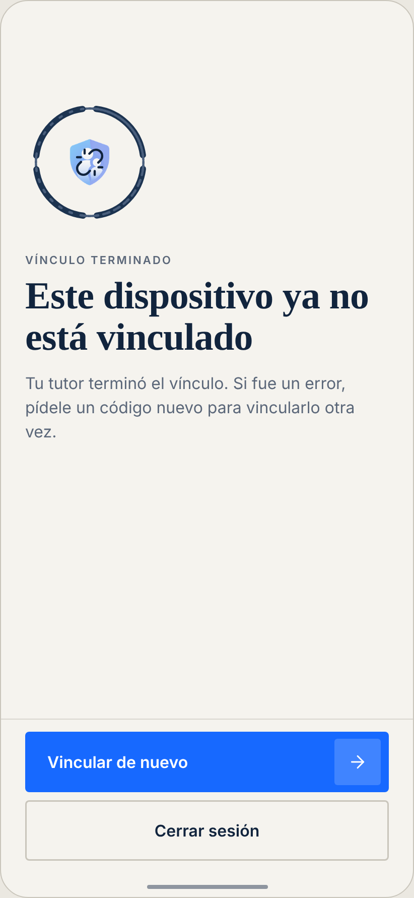

Textos (en orden de lectura):

- VÍNCULO TERMINADO
- Este dispositivo ya no está vinculado
- Tu tutor terminó el vínculo. Si fue un error, pídele un código nuevo para vincularlo otra vez.
- Vincular de nuevo
- Cerrar sesión

### 5 · PRIVACIDAD

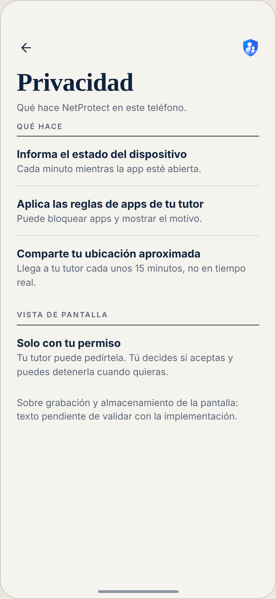

Textos (en orden de lectura):

- Privacidad
- Qué hace NetProtect en este teléfono.
- QUÉ HACE
- Informa el estado del dispositivo
- Cada minuto mientras la app esté abierta.
- Aplica las reglas de apps de tu tutor
- Puede bloquear apps y mostrar el motivo.
- Comparte tu ubicación aproximada
- Llega a tu tutor cada unos 15 minutos, no en tiempo real.
- VISTA DE PANTALLA
- Solo con tu permiso
- Tu tutor puede pedírtela. Tú decides si aceptas y puedes detenerla cuando quieras.
- Sobre grabación y almacenamiento de la pantalla: texto pendiente de validar con la implementación.

---

## 11 · Detalle de permiso

**Archivo(s) en la app:** `mobile/app/src/main/java/com/netprotect/app/feature/supervised/permissions/ (pantalla nueva)`

Una pantalla por permiso: qué habilita, cómo activarlo en 3 pasos, "Abrir Ajustes". Al volver muestra "Comprobando…" y NO marca nada como listo hasta que Android responda; luego "Configurado".

Lámina completa: `capturas/laminas/11-Detalle.png`

### 1 · PERMISO PENDIENTE

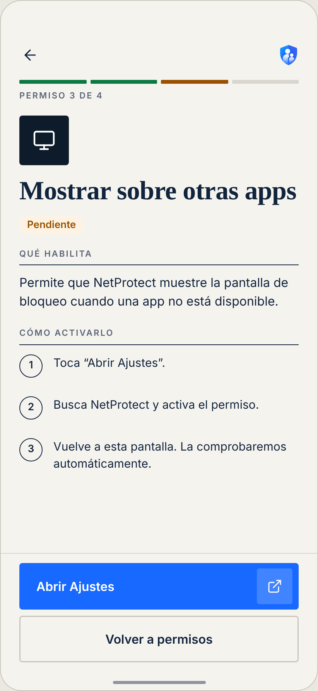

Textos (en orden de lectura):

- PERMISO 3 DE 4
- Mostrar sobre otras apps
- Pendiente
- QUÉ HABILITA
- Permite que NetProtect muestre la pantalla de bloqueo cuando una app no está disponible.
- CÓMO ACTIVARLO
- 1
- Toca “Abrir Ajustes”.
- 2
- Busca NetProtect y activa el permiso.
- 3
- Vuelve a esta pantalla. La comprobaremos automáticamente.
- Abrir Ajustes
- Volver a permisos

### 2 · COMPROBANDO AL VOLVER DE AJUSTES

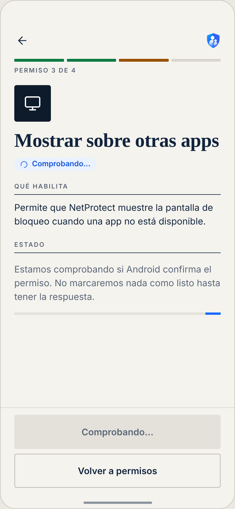

Textos (en orden de lectura):

- PERMISO 3 DE 4
- Mostrar sobre otras apps
- QUÉ HABILITA
- Permite que NetProtect muestre la pantalla de bloqueo cuando una app no está disponible.
- ESTADO
- Estamos comprobando si Android confirma el permiso. No marcaremos nada como listo hasta tener la respuesta.
- Comprobando…
- Volver a permisos

### 3 · PERMISO CONFIGURADO

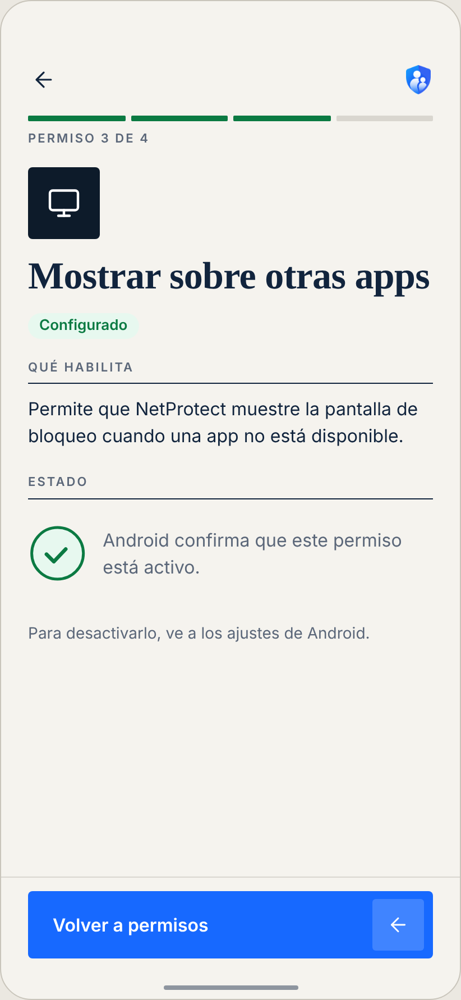

Textos (en orden de lectura):

- PERMISO 3 DE 4
- Mostrar sobre otras apps
- Configurado
- QUÉ HABILITA
- Permite que NetProtect muestre la pantalla de bloqueo cuando una app no está disponible.
- ESTADO
- Android confirma que este permiso está activo.
- Para desactivarlo, ve a los ajustes de Android.
- Volver a permisos

---

## 13 · Casos reales

**Archivo(s) en la app:** `mobile/app/src/main/java/com/netprotect/app/feature/supervised/ (nuevas pantallas) + core/permissions/`

Bienvenida de 2 pasos tras vincular; batería limita a NetProtect (pasos por validar en un Samsung real; los nombres cambian por fabricante); permiso desactivado desde Ajustes con "Activar de nuevo" y el aviso de Android correspondiente. El tutor ve ese permiso como pendiente.

Lámina completa: `capturas/laminas/13-Casos.png`

### 1 · BIENVENIDA: VINCULADO

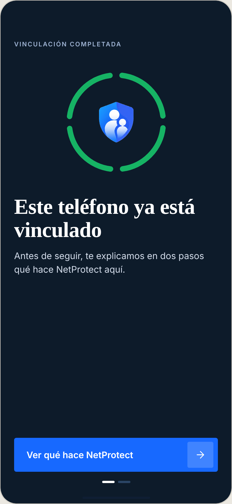

Textos (en orden de lectura):

- VINCULACIÓN COMPLETADA
- Este teléfono ya está vinculado
- Antes de seguir, te explicamos en dos pasos qué hace NetProtect aquí.
- Ver qué hace NetProtect

### 2 · BIENVENIDA: QUÉ VE EL TUTOR

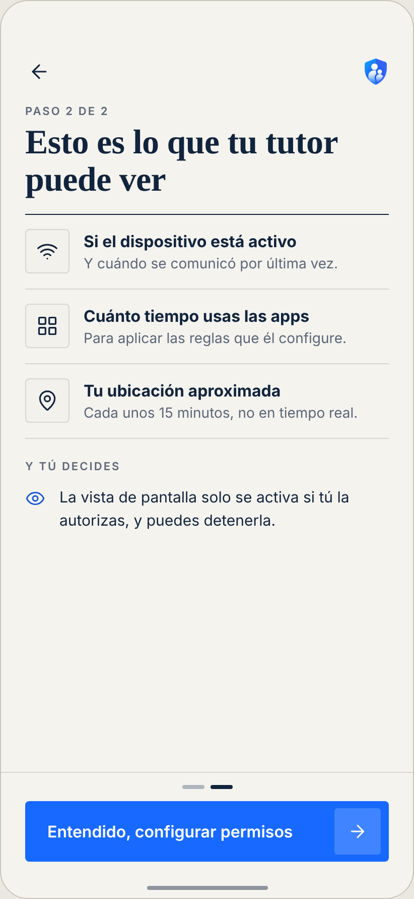

Textos (en orden de lectura):

- PASO 2 DE 2
- Esto es lo que tu tutor puede ver
- Si el dispositivo está activo
- Y cuándo se comunicó por última vez.
- Cuánto tiempo usas las apps
- Para aplicar las reglas que él configure.
- Tu ubicación aproximada
- Cada unos 15 minutos, no en tiempo real.
- Y TÚ DECIDES
- La vista de pantalla solo se activa si tú la autorizas, y puedes detenerla.
- Entendido, configurar permisos

### 3 · BATERÍA LIMITA A NETPROTECT

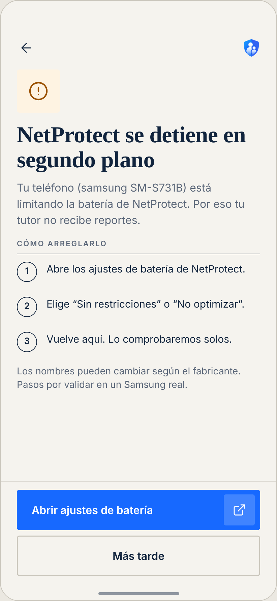

Textos (en orden de lectura):

- NetProtect se detiene en segundo plano
- Tu teléfono (samsung SM-S731B) está limitando la batería de NetProtect. Por eso tu tutor no recibe reportes.
- CÓMO ARREGLARLO
- 1
- Abre los ajustes de batería de NetProtect.
- 2
- Elige “Sin restricciones” o “No optimizar”.
- 3
- Vuelve aquí. Lo comprobaremos solos.
- Los nombres pueden cambiar según el fabricante. Pasos por validar en un Samsung real.
- Abrir ajustes de batería
- Más tarde

### 4 · PERMISO DESACTIVADO (EN LA APP)

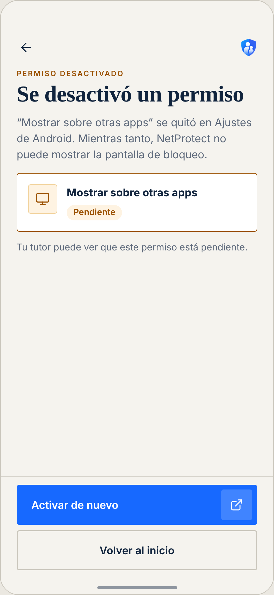

Textos (en orden de lectura):

- PERMISO DESACTIVADO
- Se desactivó un permiso
- “Mostrar sobre otras apps” se quitó en Ajustes de Android. Mientras tanto, NetProtect no puede mostrar la pantalla de bloqueo.
- Mostrar sobre otras apps
- Pendiente
- Tu tutor puede ver que este permiso está pendiente.
- Activar de nuevo
- Volver al inicio

### 5 · AVISO DE ANDROID POR PERMISO DESACTIVADO

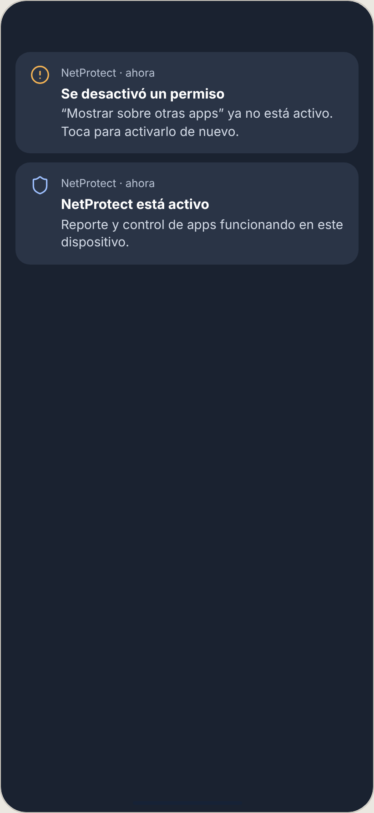

Textos (en orden de lectura):

- NetProtect · ahora
- Se desactivó un permiso
- “Mostrar sobre otras apps” ya no está activo. Toca para activarlo de nuevo.
- NetProtect está activo
- Reporte y control de apps funcionando en este dispositivo.

---

## 14 · Variante B: Inicio unificado

**Archivo(s) en la app:** `(solo para prueba A/B)`

Alternativa con pestañas Permisos | Funciones en una sola pantalla. NO implementar en el primer ciclo: se construye solo si el plan de prueba (`05_PRUEBA_USUARIOS.md`) lo pide. Variante A (la de las demás láminas) es la línea base.

Lámina completa: `capturas/laminas/14-Variante.png`

### VARIANTE B · PESTAÑA PERMISOS

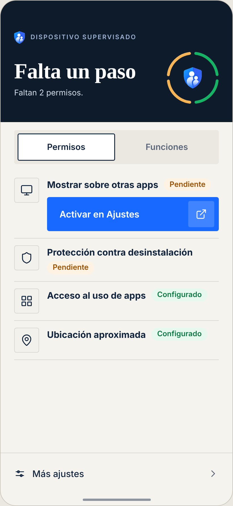

Textos (en orden de lectura):

- DISPOSITIVO SUPERVISADO
- Falta un paso
- Faltan 2 permisos.
- Permisos
- Funciones
- Mostrar sobre otras apps
- Pendiente
- Activar en Ajustes
- Protección contra desinstalación
- Acceso al uso de apps
- Configurado
- Ubicación aproximada

### VARIANTE B · PESTAÑA FUNCIONES

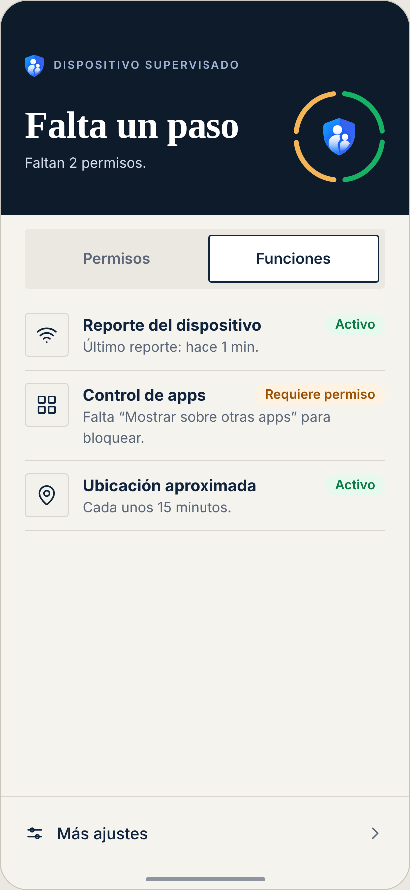

Textos (en orden de lectura):

- DISPOSITIVO SUPERVISADO
- Falta un paso
- Faltan 2 permisos.
- Permisos
- Funciones
- Reporte del dispositivo
- Activo
- Último reporte: hace 1 min.
- Control de apps
- Requiere permiso
- Falta “Mostrar sobre otras apps” para bloquear.
- Ubicación aproximada
- Cada unos 15 minutos.
